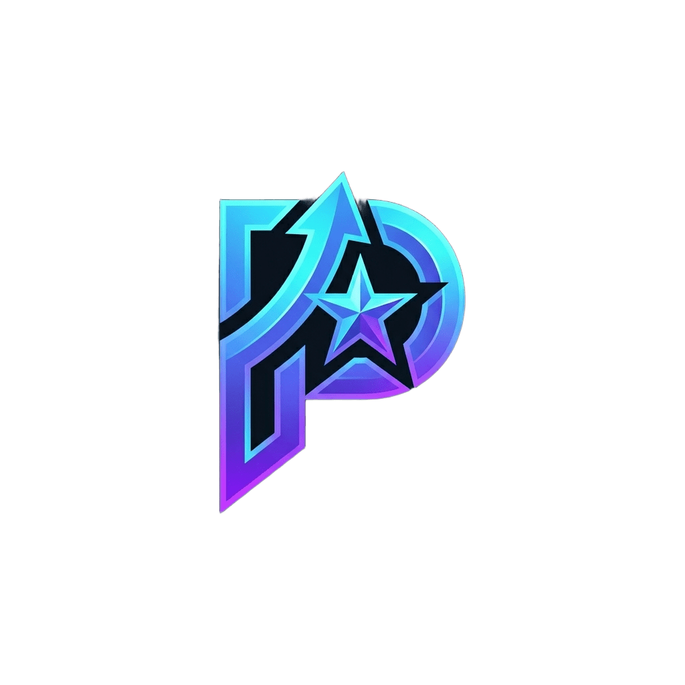
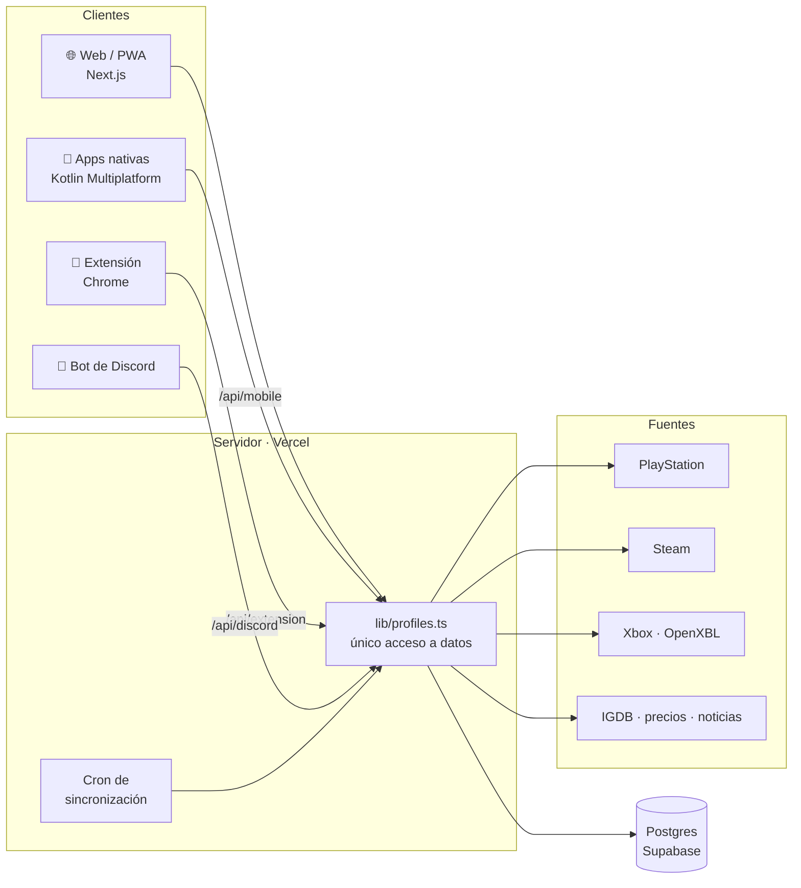

<div align="center">
  

  # Paragon

  ### Todos tus trofeos y logros, en un solo sitio.

  PlayStation, Steam, Xbox y Epic Games juntos en un perfil de jugador único:<br/>
  qué te falta para el 100 %, cómo vas contra tus amigos y cuál es tu próximo platino.

  **[www.paragontrophies.com](https://www.paragontrophies.com)**

  <br/>

  
  
  
  
  <br/>
  
  
  
  
  <br/>
  

</div>

---

## 🏆 Qué es Paragon

Si juegas en consola **y** en PC, tus logros viven separados: los trofeos en PlayStation, los logros en Steam, Xbox y Epic, cada uno con su lista y su porcentaje. **Paragon los junta en un único perfil de jugador.**

- Lee tu progreso **real** de cada plataforma (nada de apuntarlo a mano).
- Te ordena la biblioteca por **lo que te falta**, no por lo que ya tienes.
- Lo convierte en algo **social**: amigos, ligas, clanes, comparativas y un nivel Paragon que suma todo lo que consigues, juegues donde juegues.

Está disponible como **web** (instalable como PWA), como **app nativa para Android e iOS** y con una **extensión de navegador** para sincronizar PlayStation y Epic Games.

## ✨ Funciones

<table>
<tr>
<td width="50%" valign="top">

### 🎮 Tu progreso
- **Biblioteca unificada** de todas tus plataformas, con filtros y carpetas propias.
- **Ficha de cada juego**: trofeos por DLC, perdibles marcados aparte, guías de vídeo y guías de la comunidad.
- **Nivel Paragon**: cada trofeo o logro da experiencia, sin importar la plataforma.
- **Diario del platino** y gráfica de cómo lo fuiste consiguiendo.
- **Modo enfoque**: el juego que estás cazando, a pantalla completa, con los trofeos más a mano.

</td>
<td width="50%" valign="top">

### 👥 Social y competición
- **Amigos por @handle** y comparativas juego a juego (o en grupo).
- **Ligas** privadas mensuales con ranking y podio, y **temporadas**.
- **Clanes**, comunidad con reseñas, comentarios y guías.
- **Retos entre amigos** y **sesiones** para quedar a jugar.
- **Perfil público** con insignias, hoja de servicios y vitrina.

</td>
</tr>
<tr>
<td valign="top">

### 📊 Estadísticas
- **El Wrap**: tu año en trofeos (racha, mejor mes, género favorito, juego más exprimido…).
- **Tu ritmo**: predicción de cuándo terminarás cada juego a tu ritmo real.
- **Planificador** del backlog con horas estimadas (HowLongToBeat).
- Salud de la sincronización de cada cuenta.

</td>
<td valign="top">

### 🔭 Descubrir
- Catálogo mundial de juegos cruzado con **IGDB**.
- **Próximos lanzamientos**: los más esperados de verdad.
- Precios e histórico (**CheapShark** + **IsThereAnyDeal**), juegos gratis de Epic y Game Pass.
- **Noticias** y **eSports** en directo (PandaScore).
- Recomendaciones según tus géneros.

</td>
</tr>
<tr>
<td valign="top">

### 🔔 Avisos
- **Push** en el navegador, en Android (FCM) y en iPhone (APNs).
- **Bot de Discord** con mensajes directos y comandos.
- **Bandeja de avisos** en la web y en la app, en vivo.
- Tú eliges qué recibir y por dónde.

</td>
<td valign="top">

### 🛠️ Y además
- **6 idiomas**: español, inglés, alemán, francés, italiano y portugués.
- **Panel de administración** con analítica propia sin cookies, registro y control del sistema.
- **Copia de seguridad** semanal cifrada de la base de datos.
- Un **easter egg** jugable en la pantalla sin conexión. 🦖

</td>
</tr>
</table>

## 🕹️ Plataformas

| | Plataforma | Cómo se lee el progreso | Cuenta verificada |
|:-:|---|---|:-:|
|  | **PlayStation** | API de PSN con una credencial del servidor, o la extensión del navegador | — |
|  | **Steam** | Steam Web API (perfil público) | ✅ «Iniciar sesión con Steam» (OpenID) |
|  | **Xbox** | OpenXBL (servicio no oficial) | — |
|  | **Epic Games** | Extensión del navegador (Epic bloquea las lecturas desde servidores) | ✅ Epic Account Services |
|  | **Nintendo** | No tiene ninguna API pública de logros | — |

> 🔒 **Nadie entrega su contraseña.** Cada plataforma se lee con el identificador público de tu cuenta, y los inicios de sesión oficiales de Steam y Epic solo confirman qué cuenta es tuya. El login en Paragon es con **Google** o **Discord**.

## 🧱 Cómo está montado



- **Las páginas nunca hablan con una plataforma ni con la base de datos directamente**: todo pasa por `lib/profiles.ts`. Añadir una plataforma se hace ahí, sin tocar pantallas.
- **Las páginas públicas sin sesión** (inicio, fichas de juego, perfiles) se sirven estáticas desde la CDN, y las demás se renderizan en el servidor.
- **La sincronización** corre sola por tandas (cron) y también a demanda desde la web, la app o la extensión.

### Stack

| Capa | Tecnología |
|---|---|
| Web | Next.js 16 (App Router), React 19, TypeScript, Tailwind CSS v4, Framer Motion |
| Datos | Postgres en Supabase, Drizzle ORM |
| Login | Auth.js v5 (Google, Discord, Epic Games) |
| Idiomas | next-intl (web), generador propio para las apps (`kmp/i18n`) |
| Apps | Kotlin Multiplatform + Compose Multiplatform (Android e iOS) |
| Avisos | Web Push (VAPID), Firebase Cloud Messaging, APNs, Discord |
| Pruebas | Vitest, ESLint, TypeScript estricto, GitHub Actions |

### Estructura del repositorio

```
📦 paragon
├── src/
│   ├── app/            Páginas y rutas de API (App Router)
│   │   ├── (app)/      La web con sesión
│   │   ├── (publico)/  Páginas públicas servidas desde la CDN
│   │   └── api/        Cron, app móvil, extensión, Discord, OG…
│   ├── components/     Componentes de React
│   ├── lib/            Lógica: un cliente por plataforma, sincronización, estadísticas…
│   ├── i18n/           Configuración de idiomas y qué textos van a cada página
│   ├── db/             Esquema de la base de datos (Drizzle)
│   └── proxy.ts        Reparte entre páginas públicas y con sesión
├── messages/           Traducciones de la web (6 idiomas por namespace)
├── kmp/                Apps nativas de Android e iOS (Kotlin Multiplatform)
├── extension/          Extensión de navegador (PlayStation y Epic)
├── video/              Vídeo de promoción y gráficos de las tiendas (Remotion)
├── scripts/            Herramientas: copia de seguridad, empaquetar la extensión…
│   └── migraciones/    Cambios de la base de datos aplicados a mano, uno por archivo
├── tests/              Pruebas (Vitest)
├── public/             Logo, iconos y archivos estáticos
├── docs/               Estado del proyecto, historial, diseño y producto
└── .github/workflows/  CI, apps, publicación en tiendas, copias de seguridad
```

Los archivos sueltos de la raíz son la configuración que Next.js, TypeScript,
ESLint, Vitest, Drizzle y Vercel buscan ahí, y `AGENTS.md`/`CLAUDE.md`, las
instrucciones para los asistentes de código.

## 🚀 Puesta en marcha

```bash
npm install
# Crea .env.local con las variables de abajo
npm run db:push     # crea las tablas en la base de datos
npm run dev         # http://localhost:3000
```

<details>
<summary><b>🔑 Variables de entorno</b></summary>

<br/>

| Variable | Para qué | |
|---|---|:-:|
| `DATABASE_URL` | Postgres (Supabase) | obligatoria |
| `AUTH_SECRET` | Cifrado de sesiones de Auth.js | obligatoria |
| `AUTH_GOOGLE_ID` / `_SECRET` | Login con Google | obligatoria |
| `AUTH_DISCORD_ID` / `_SECRET` | Login con Discord | obligatoria |
| `PSN_NPSSO` | Lector de PlayStation (caduca cada ~2 meses) | |
| `STEAM_API_KEY` | Lector de Steam | |
| `XBL_API_KEY` | Lector de Xbox (OpenXBL) | |
| `AUTH_EPIC_ID` / `_SECRET` | Verificar la cuenta de Epic Games | opcional |
| `IGDB_CLIENT_ID` / `_SECRET` | Catálogo de juegos (OAuth de Twitch) | |
| `CRON_SECRET` | Protege la sincronización automática | |
| `ITAD_API_KEY` | Histórico de precios | opcional |
| `PANDASCORE_API_KEY` | eSports | opcional |
| `VAPID_PUBLIC_KEY`, `VAPID_PRIVATE_KEY`, `NEXT_PUBLIC_VAPID_PUBLIC_KEY` | Push del navegador | opcional |
| `FIREBASE_SERVICE_ACCOUNT_KEY` | Push en Android | opcional |
| `APNS_KEY`, `APNS_KEY_ID`, `APNS_TEAM_ID`, `APNS_TOPIC` | Push en iPhone | opcional |
| `DISCORD_BOT_TOKEN`, `DISCORD_PUBLIC_KEY`, `DISCORD_APPLICATION_ID` | Bot de Discord | opcional |
| `NEXT_PUBLIC_SUPABASE_URL`, `SUPABASE_SERVICE_ROLE_KEY` | Subida de avatares y banners | opcional |
| `NEXT_PUBLIC_ADSENSE_CLIENT`, `NEXT_PUBLIC_ADSENSE_SLOT` | Anuncios (apagados por defecto) | opcional |

Al desplegar, registra las URL de redirección de OAuth con el dominio real.

</details>

### Comandos

| Comando | Qué hace |
|---|---|
| `npm run dev` | Servidor de desarrollo |
| `npm run build` · `npm start` | Build y arranque de producción |
| `npm run lint` | ESLint |
| `npm test` | Pruebas con Vitest |
| `npm run test:namespaces` | Comprueba que todas las traducciones que usa el cliente se envían |
| `npm run db:push` · `npm run db:studio` | Aplicar el esquema · explorar la base de datos |
| `npm run extension:zip` | Empaqueta la extensión para descargarla o subirla a la Chrome Web Store |

Las apps nativas se compilan desde `kmp/` con Gradle y Xcode. En GitHub Actions se compilan solas y se publican en las tiendas.

## 📚 Documentación

| Documento | Contenido |
|---|---|
| [`docs/HANDOFF.md`](docs/HANDOFF.md) | **Empieza aquí**: estado actual, qué falta y reglas del proyecto |
| [`docs/HISTORIAL.md`](docs/HISTORIAL.md) | Todo lo que se ha hecho y por qué, de lo más nuevo a lo más viejo |
| [`docs/DESIGN.md`](docs/DESIGN.md) | Sistema de diseño de la web |
| [`docs/PRODUCT.md`](docs/PRODUCT.md) · [`docs/CONTEXTO.md`](docs/CONTEXTO.md) | Producto, usuarios y visión |
| [`docs/HALLAZGOS.md`](docs/HALLAZGOS.md) | Lo que se descubrió al conectar las plataformas de verdad |
| [`docs/ROADMAP.md`](docs/ROADMAP.md) · [`docs/PLAN-NATIVA.md`](docs/PLAN-NATIVA.md) | Lo que viene y el plan de las apps nativas |
| [`docs/CHROME-WEB-STORE.md`](docs/CHROME-WEB-STORE.md) | Ficha y permisos para publicar la extensión |
| [`kmp/MIGRACION.md`](kmp/MIGRACION.md) | Las apps nativas en Kotlin Multiplatform |
| [`extension/README.md`](extension/README.md) | La extensión de navegador |

## ⚠️ Limitaciones conocidas

- **Un perfil en privado no se puede sincronizar**: Paragon lee lo que cada plataforma hace público (y avisa si deja de poder leerse).
- **Xbox va por un servicio no oficial** (OpenXBL), con un cupo gratuito compartido: puede fallar a ratos.
- **Epic Games** no deja leer logros desde servidores: se sincroniza con la extensión del navegador.
- **Nintendo** no tiene ninguna API pública de logros.
- **Qué coleccionable concreto te falta** no lo da ninguna API: vive en la partida guardada de cada juego.

---

<div align="center">
  <sub>Hecho con 🏆 por <a href="https://github.com/mariioogrciia">Mario García</a> · Proyecto personal, no afiliado a Sony, Valve, Microsoft, Epic Games ni Nintendo.</sub>
</div>
